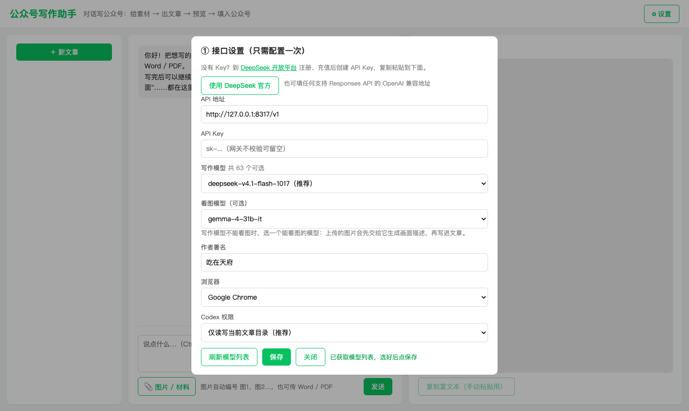
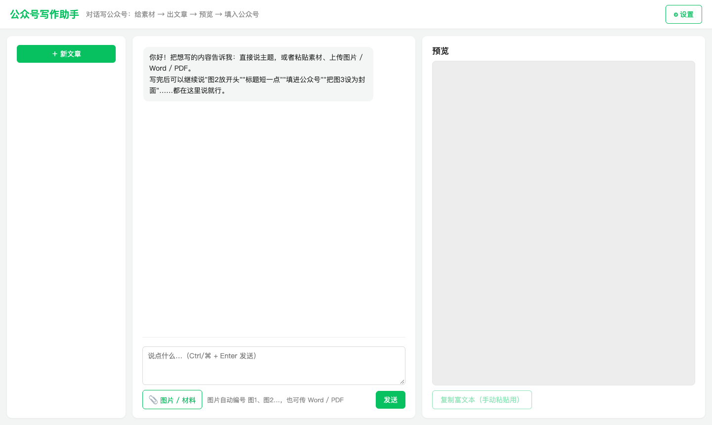
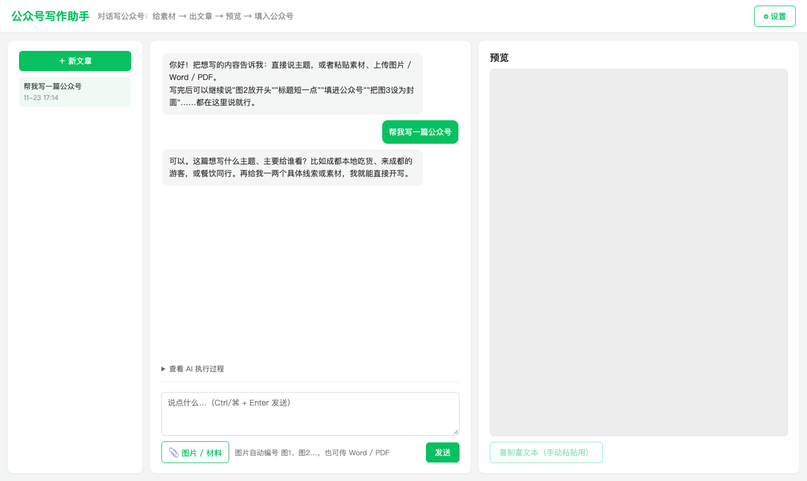
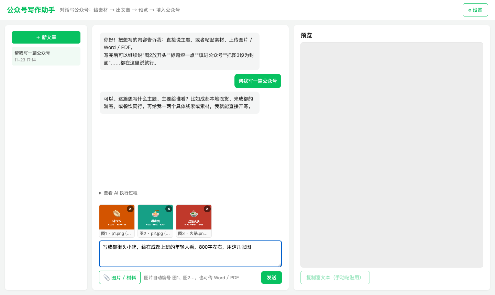
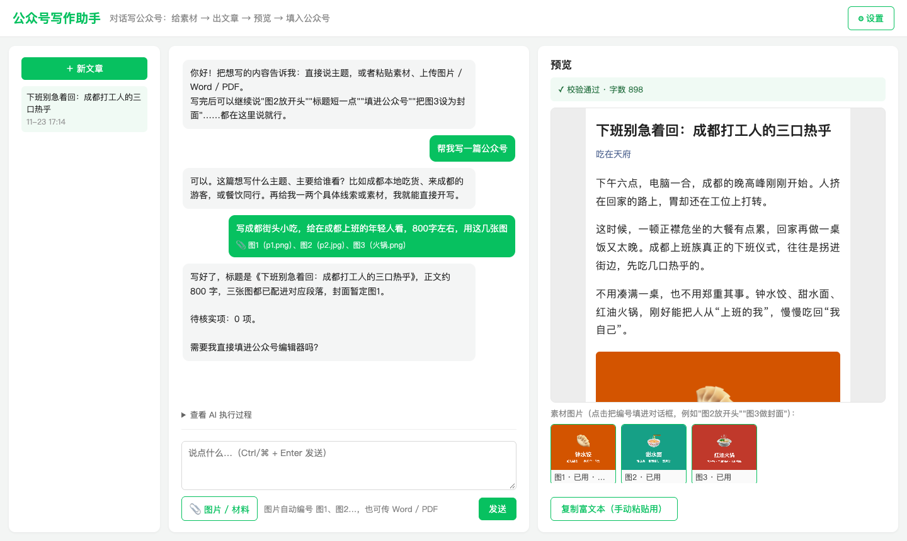
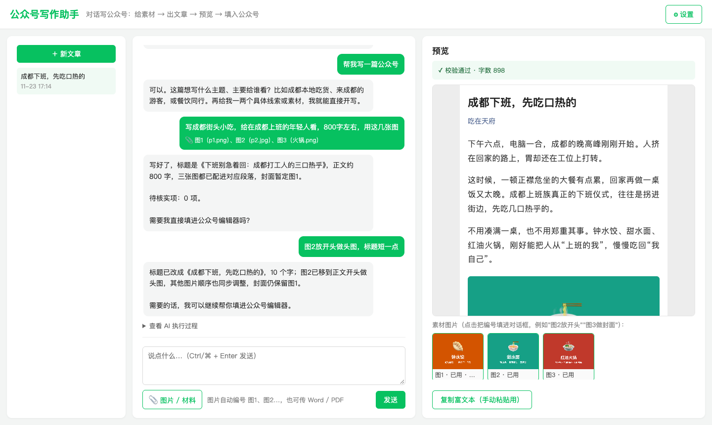
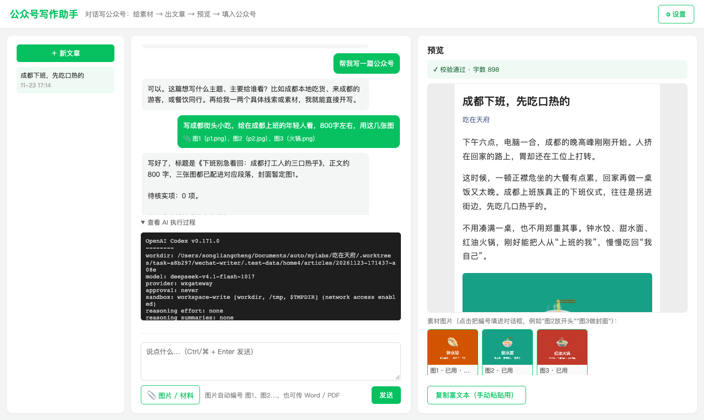
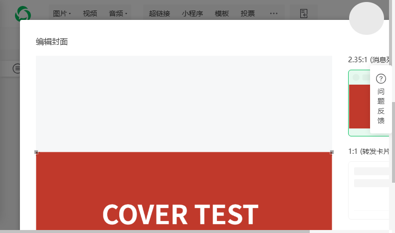
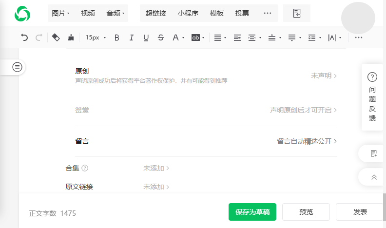

# 公众号写作助手 · 图文教程

一句话：**和 AI 聊天写公众号**。给它主题和素材（文字、图片、Word、PDF），它写稿、配图、选封面；你说"填进公众号"，它自己打开公众号后台把文章填好，最后由你点「发表」。

全程只有一个对话框，不用填表单。

| 你需要准备 | 说明 |
|---|---|
| DeepSeek API Key | 第 1 步申请，按量付费，写一篇通常几分钱到一两毛 |
| 一台电脑 | Windows 10/11、macOS、Linux（x64 / ARM64） |
| 浏览器 | Windows 用系统自带 Edge；macOS / Linux 装 Google Chrome |
| 公众号管理员微信 | 填进公众号时扫码登录一次（之后会记住） |

**不需要**另装 Node.js、Codex 或任何开发环境，应用都自带了。

---

## 1. 申请 DeepSeek API Key

1. 打开 <https://platform.deepseek.com>，注册 / 登录并完成实名认证；
2. 左侧「充值」，充最低金额即可；
3. 左侧「API Keys」→「创建 API Key」，名字随便写；
4. **立刻复制保存** Key（形如 `sk-xxxx`），关掉弹窗后就看不到了。

---

## 2. 下载并启动

到 [Releases 发布页](https://github.com/slcnx/wechat-writer/releases/latest) 下载对应的文件：

| 你的电脑 | 下载 |
|---|---|
| Windows（大多数电脑） | `wechat-writer-<版本>-win-x64.zip` |
| Windows ARM（骁龙笔记本、Mac 上的 Windows 虚拟机） | `wechat-writer-<版本>-win-arm64.zip` |
| Mac（M 系列芯片） | `wechat-writer-<版本>-mac-arm64.tar.gz` |
| Mac（Intel 芯片） | `wechat-writer-<版本>-mac-x64.tar.gz` |
| Linux | `wechat-writer-<版本>-linux-x64.tar.gz` / `-linux-arm64.tar.gz` |

> 不确定 Windows 是哪种：「设置 → 系统 → 系统信息 → 系统类型」，写着"基于 ARM"就选 arm64。

- **Windows**：右键 zip →「全部解压缩」→ 双击文件夹里的 **`start.cmd`**（提示"Windows 已保护你的电脑"时点「更多信息 → 仍要运行」）。
- **macOS**：双击解压，在「终端」执行一次 `xattr -dr com.apple.quarantine ~/Downloads/wechat-writer-*-mac-*`，再双击 **`start.command`**。
- **Linux**：`tar -xzf wechat-writer-*-linux-*.tar.gz && cd wechat-writer-*/ && ./start.sh`

会出现一个黑色命令行窗口（**别关**，关了应用就退出），浏览器自动打开 `http://127.0.0.1:8848/`。

---

## 3. 填 Key，选模型（只需一次）

第一次打开会自动弹出「接口设置」，以后点右上角 **⚙ 设置** 打开。

1. 点 **「使用 DeepSeek 官方」**（地址填成 `https://api.deepseek.com`）；也可以填你自己的 OpenAI 兼容地址，比如局域网网关（上图示例就是网关 `http://…:8317/v1`）；
2. **API Key** 粘贴第 1 步的 `sk-xxxx`；
3. 地址、Key 一填好，应用**自动拉取全部可用模型**，直接下拉选：
   - **写作模型**：没选过时自动选推荐模型并标「推荐」（DeepSeek 官方是 `deepseek-flash`，网关上优先 `deepseek-v4.1-flash-1017`）；
   - **看图模型（可选）**：写作模型不能看图时选一个能看图的（如网关上的 `gemma-4-31b-it`），上传的图片会先交给它"看"，图注才能写出图里的真实内容；
4. 填 **作者署名**，点 **保存**，关闭弹窗。

---

## 4. 开始对话

界面一屏三栏：**左**是文章列表，**中**是和 AI 的对话，**右**是手机效果预览。

点左上 **「＋ 新文章」** 开始一篇新的；点左侧标题可以回到以前的文章接着聊。

### 4.1 信息不够，AI 会先问你

只说"帮我写一篇公众号"，AI 不会乱写，而是先问写什么、给谁看：

### 4.2 说清主题，附上图片 / 材料

在对话框里说主题和要求，点 **📎 图片 / 材料** 选文件，可以多次添加，选错了点缩略图右上角 × 去掉：

- **图片**（jpg / png / gif / webp）按顺序自动编号 **图1、图2、图3……**
- **Word（.docx）**、**PDF** 会自动提取文字，Word 里的图片也会取出来接着编号；
- 也可以直接把采访记录、要点、新闻稿粘贴进对话框。

点 **发送**（或 Ctrl/⌘ + Enter）。一般 **1~5 分钟**写好，AI 会在对话里说明标题、字数、用了哪些图、封面选了哪张、哪些地方需要你确认：

右侧预览就是手机上的效果。顶部绿条是校验结果（字数、格式是否符合公众号要求、有哪些【待核实】）；下方素材图库标注每张图 **已用 / 未用 / 封面**。

---

## 5. 继续聊，改到满意

同一篇文章是一段连续对话，AI 记得前面聊过什么。想改哪里直接说：

- "图2放开头做头图""删掉图3""图1换成小图""图3做封面"
- "标题短一点""第二节加个例子""结尾引导关注""主色换成红色"
- 再附几张新图也行，新图接着编号（如 图4），说"把图4放在结尾前"

> 小技巧：点右下图库里的缩略图，会把「图N」自动填进对话框。

想看 AI 具体做了什么，点 **「查看 AI 执行过程」** 展开：

---

## 6. 填进公众号

在对话框里说 **"填进公众号"**（或"发布到公众号""存到草稿""封面用图2"）：

1. 应用打开一个**单独的** Edge / Chrome 窗口进入公众号后台；**第一次**对话上方会提示扫码，用**公众号管理员微信**扫码登录（以后会记住）；
2. AI 自己操作，约 1~2 分钟：新建图文 → 把素材图片传到你公众号的**图片素材库** → 填标题、作者、正文、摘要 → 设置封面（从图片库选中，保持默认裁剪确认）→ 检查一遍；

   

3. AI 在对话里告诉你填了什么、有没有要你确认的；之后还可以接着说"封面换成图3""摘要再短一点""检查图片是不是都传上去了"；
4. 你在那个浏览器窗口里检查一遍，**自己点「保存为草稿」或「发表」**。

   

> 应用和 AI **都不会**点「发表 / 群发 / 保存为草稿」，发布一定由你本人确认。

**万一自动填写失败**：点预览下方 **「复制富文本」**，到公众号编辑器正文处 `Ctrl+V` 粘贴（Mac 用 `⌘+V`）。手动粘贴不会上传本地图片，有图时还是让 AI 填更省事。

---

## 7. 安全与权限

- API Key 只保存在你电脑的用户目录 `.wechat-writer/settings.json`，不会上传到别处；
- AI 默认只能读写**当前这篇文章的目录**，碰不到你电脑上的其他文件（设置里可改成"完全访问"，不建议：素材来自外部，可能夹带恶意指令）；
- 操作公众号时 AI 只连本机那个浏览器窗口，不读取 Cookie 等账号信息，不点发表 / 群发 / 保存草稿。

---

## 8. 常见问题

| 现象 | 处理 |
|---|---|
| 设置里"获取模型失败" / 401 | Key 复制不完整或已删除；到 DeepSeek 平台重新创建 |
| 402 / 余额不足 | 到 DeepSeek 平台充值 |
| 一直显示"AI 正在处理…" | 展开「查看 AI 执行过程」看进度；网络不稳就再发一次 |
| 执行过程里出现"当前模型不支持看图" | 正常降级：按文件名和上下文排图；想让图注准确，在设置里选一个「看图模型」 |
| 图注把图里的字认错了 | 看图模型偶尔会认错字，直接说"图3写的是春熙路，图注改一下" |
| 扫码后 AI 还说没登录 | 在弹出的浏览器里确认已进入公众号后台首页，再说一次"填进公众号" |
| 浏览器打不开 | 设置里切换 Edge / Chrome；关掉这个浏览器的其他窗口再试 |
| 端口 8848 被占用 | 关掉之前打开的黑色窗口；或设环境变量 `WX_WRITER_PORT=8849` 再启动 |
| 换电脑 / 重装 | 数据都在用户目录 `.wechat-writer`（设置、文章、对话、浏览器登录态），拷过去即可 |

开发、构建、自建网关等进阶内容见 [开发与部署.md](开发与部署.md)。
